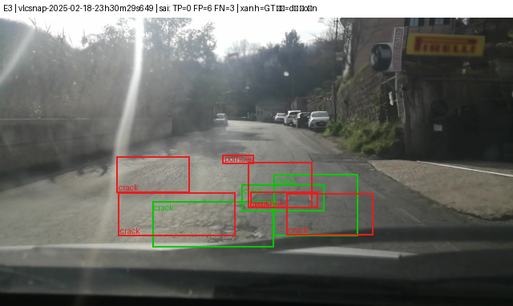
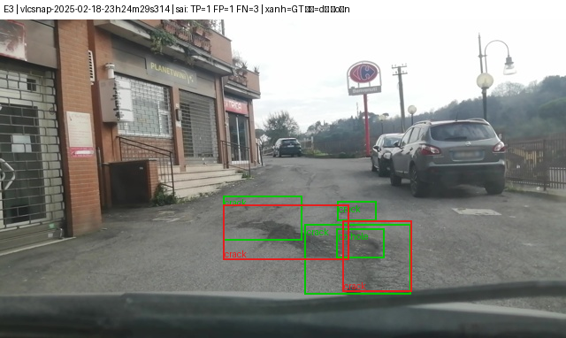
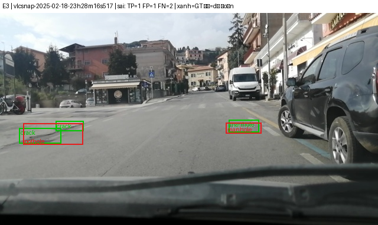
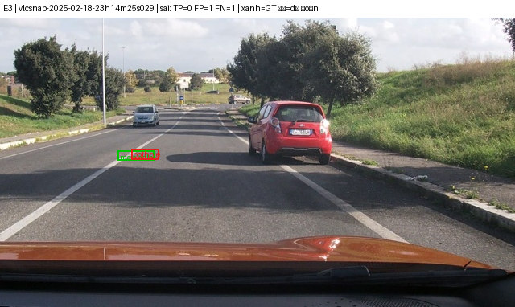
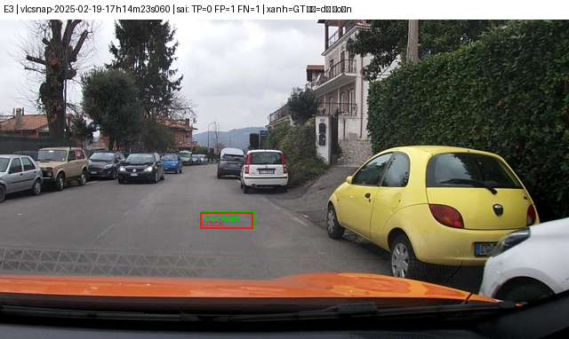
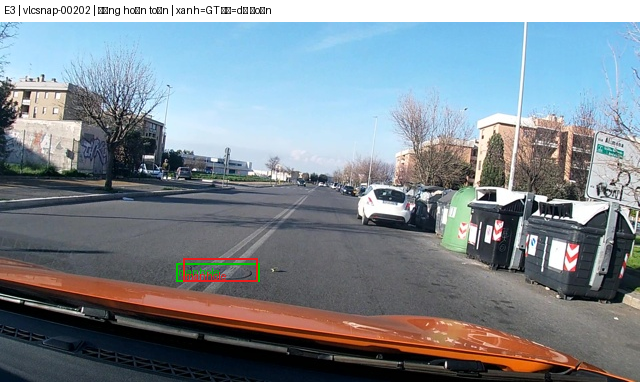
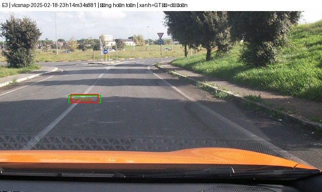
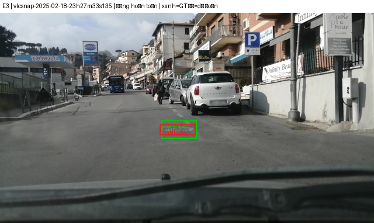

Họ tên: Hoàng Trung Anh
`dataset_version`: d10-21e4070301

## Bảng tổng hợp (số của bạn, lấy từ `report/evidence/*.json`)

| Mã | Setup | Tham số huấn luyện | VRAM đỉnh (GB) | Phút | F1 | CI95 | FP/ảnh | F1 pothole | F1 crack | F1 manhole |
|---|---|---|---|---|---|---|---|---|---|---|
| E0 | zero-shot | 0 | – | – | 0,053 | 0,035–0,074 | 1,43 | 0,078 | 0,016 | 0,128 |
| E1 | LoRA LLM | 33.030.144 | 6,57 | 45,05 | 0,262 | 0,226–0,299 | 1,26 | 0,176 | 0,192 | 0,514 |
| E2 | + projector | 142.135.296 | 8,27 | 46,22 | 0,348 | 0,310–0,388 | 1,07 | 0,262 | 0,263 | 0,604 |
| E3 | + LoRA ViT | 148.426.752 | 8,45 | 53,03 | 0,423 | 0,384–0,465 | 0,90 | 0,260 | 0,357 | 0,683 |
| E4 | rank r=4 (α=8), cấu hình E3 | 118.935.552 | 8,01 | 53,07 | 0,421 | 0,380–0,466 | 0,86 | 0,283 | 0,351 | 0,667 |
| E4 | rank r=64 (α=128), cấu hình E3 | 266.391.552 | 10,24 | 54,34 | 0,447 | 0,405–0,489 | 0,92 | 0,286 | 0,383 | 0,701 |

Ghi chú môi trường: E0–E2 chạy trên Google Colab (Tesla T4), E3 và E4 chạy trên Kaggle (2× Tesla T4, dùng 1 GPU). Cùng mã (commit `lab/` trong repo), cùng split `d10-21e4070301`. Thời gian và VRAM lấy từ `meta` của từng file bằng chứng.

## 10 câu hỏi

### Câu 1 — Kiến trúc: ViT, projector và LLM của Qwen3-VL-4B có bao nhiêu tham số mỗi khối, và E1/E2/E3 mỗi cái cập nhật khối nào?
Số đo được khi huấn luyện:
- **E1**: LoRA r=16 trên 252 module LLM (q,k,v,o,gate,up,down × 36 tầng) → **33.030.144** tham số huấn luyện. ViT và projector đóng băng.
- **E2**: thêm mở đầy đủ projector (`visual.merger` và `visual.deepstack_merger_list`, float32) → **109.105.152** tham số projector, tổng 142.135.296.
- **E3**: thêm LoRA trên 96 module ViT (`attn.qkv, attn.proj, mlp.linear_fc1, mlp.linear_fc2` × 24 block) → 348 module LoRA, tổng 148.426.752 (LoRA ViT = 6.291.456).

Số lấy từ đề (GUIDE), chưa tự đo lại: ViT ≈ 415 triệu (kèm projector), LLM ≈ 4,0 tỷ, tổng ≈ 4,44 tỷ.

### Câu 2 — E0: `parse_valid_rate` bằng bao nhiêu, và hai lỗi phổ biến nhất của model gốc là gì (kèm một ví dụ output thô)?
`parse_valid_rate` = **0,794** (247/311 ảnh đọc được JSON, 64 ảnh hỏng). Hai lỗi chính:
1. **Box bịa / sai vị trí**: precision 0,059 (446 FP, 28 TP; 1,43 FP/ảnh). Ví dụ (ảnh `vlcsnap-00201`): `[{"label": "crack", "bbox_2d": [0, 450, 1000, 500]}]` — một vết nứt chạy suốt chiều ngang ảnh, không phải định vị thật.
2. **Lặp box**: model lặp lại cùng một box nhiều lần (ví dụ ảnh `vlcsnap-00202`: `[{"label": "manhole", "bbox_2d": [320, 686, 399, 714]}, {"label": "manhole", "bbox_2d": [320, 686, 399, 714]}, …]`). Output dài có thể chạm giới hạn 256 token và bị cắt → JSON hỏng. Tôi chưa phân loại từng ảnh hỏng, chỉ ghi nhận nguyên nhân khả dĩ từ các ví dụ này.

Khi box khớp, IoU trung bình đã 0,619, nghĩa là model hiểu định dạng và thang toạ độ; cái yếu là tìm đúng đối tượng.

### Câu 3 — Thang 0–1000: nếu chấm output theo pixel (hoặc ngược lại) thì F1 ra sao và vì sao? Bạn đã kiểm chứng điều này thế nào?
Đo trên cùng file dự đoán E3 của tập test (`lab/analyze.py`, kết quả trong `report/analysis.json` trên Kaggle):

| Cách đọc toạ độ | F1 | Precision | Recall | TP |
|---|---|---|---|---|
| Thang 0–1000 (đúng) | 0,423 | 0,452 | 0,398 | 232 |
| Đọc như pixel (sai) | 0,000 | 0,000 | 0,000 | 0 |

Nếu hiểu nhầm thang, điểm sụp về 0 hoàn toàn: mọi box bị đọc như toạ độ pixel nên không còn khớp GT với IoU ≥ 0,5. Đây là điểm kiểm chứng để tránh lỗi này: `analysis.json` luôn chấm kèm hai cách đọc và phải thấy thang 0–1000 cho F1 cao, pixel cho F1 ~0.

### Câu 4 — Mask loss: vì sao chỉ tính loss trên phần trả lời? Điều gì xảy ra nếu tính trên cả prompt và token ảnh?
Với ảnh 640×360 có **220 token ảnh** (đã kiểm chứng bằng test `test_encode_example_masks_prompt_and_image_tokens`, chạy pass với processor thật). `encode_example` đặt `labels = -100` cho toàn bộ prompt và token ảnh, assert rằng prompt là tiền tố của chuỗi đầy đủ, chỉ học JSON đáp án và `<|im_end|>`.
Nếu tính loss trên cả prompt và token ảnh: phần lớn gradient đi vào các token cố định (prompt giống nhau, token ảnh là placeholder) nên loss giảm nhanh nhưng không phản ánh chất lượng box, và phần trả lời (chỉ vài chục token) bị loãng. Với mask đúng, loss E1 giảm từ 1,72 (bước 1) xuống khoảng 0,57 ở bước 260 và 0,45 ở cuối E4.

### Câu 5 — Vì sao không thể huấn luyện đầy đủ projector nếu ViT bị lượng tử hoá 4-bit, và bạn đã xử lý thế nào? Vì sao projector phải ở float32?
Lỗi thật tôi gặp: với cấu hình GUIDE `llm_int8_skip_modules=["visual","lm_head"]`, `transformers==5.19.0` vẫn lượng tử hoá ViT và projector. `lab.diagnose` cho thấy **96 `Linear4bit` trong ViT và 8 trong projector**, trọng số là `uint8` đóng gói (ví dụ `merger.linear_fc1.weight` shape `(8388608, 1)`). Nguyên nhân: `should_convert_module` so khớp bằng `re.match` neo ở đầu tên đầy đủ (`model.visual…`) nên mẫu `"visual"` không khớp. Khối đóng gói không có gradient: `requires_grad=True` báo `only Tensors of floating point … can require gradients`.

Xử lý: đổi mẫu thành `"model.visual"` (có test `test_skip_quant_keeps_vit_projector_and_lm_head_unquantized`). Sau đó E3 chạy với projector và LoRA ở float32 (log: `dtype: ['torch.float32']`).

Vì sao float32: `GradScaler` của AMP fp16 không unscale được gradient fp16 (gặp đúng `Attempting to unscale FP16 gradients`); và với lr 2e-4 các cập nhật AdamW nhỏ hơn bước làm tròn của fp16 nên bị mất, master weights float32 cộng dồn được.

### Câu 6 — Split theo phiên quay: vì sao chia ngẫu nhiên sẽ cho F1 cao giả? Số ảnh và số box từng lớp ở mỗi split là bao nhiêu?
| Split | Ảnh | Phiên quay | pothole | crack | manhole |
|---|---|---|---|---|---|
| train | 1.422 | 13 | 1.074 | 1.750 | 691 |
| val | 276 | 2 | 66 | 470 | 103 |
| test | 311 | 3 | 121 | 299 | 163 |

(Số ảnh, box lấy từ `analysis.json`; số phiên là số `session` khác nhau trong từng split.) Tập test chỉ có 3 phiên quay. Split theo phiên nên về nguyên tắc không phiên nào nằm ở hai split cùng lúc (chưa kiểm tra giao nhau bằng code).

Vì ảnh là frame cắt từ video, hai frame liền kề gần như trùng. Chia ngẫu nhiên thì ảnh gần như giống hệt đã có trong train → F1 trên test bị thổi phồng vì model nhớ thay vì tổng quát. Chia theo phiên buộc test là đoạn đường chưa thấy.

### Câu 7 — So sánh E1/E2/E3: mở projector và LoRA trên ViT có đáng không (F1, CI95, VRAM, thời gian)?
- **E1 → E2 (+projector)**: F1 0,262 → 0,348 (+0,086), CI95 không chồng nhau (0,226–0,299 vs 0,310–0,388). FP/ảnh 1,26 → 1,07. Chi phí: +109 triệu tham số, +1,7 GB VRAM, +1,2 phút. Đáng.
- **E2 → E3 (+LoRA ViT)**: F1 0,348 → 0,423 (+0,075), FP/ảnh 1,07 → 0,90; crack 0,263 → 0,357, manhole 0,604 → 0,683, pothole gần như giữ nguyên (0,262 → 0,260). Chi phí: +6,3 triệu tham số, +0,18 GB VRAM, +6,8 phút (một phần chênh có thể do khác nền tảng). CI95 chồng nhẹ (E2 tới 0,388, E3 từ 0,384), nên cải thiện có khả năng thật nhưng chưa chắc chắn.

### Câu 8 — Tập test có 311 ảnh: khoảng tin cậy rộng thế nào, và điều đó giới hạn kết luận so sánh các setup ra sao?
CI95 (bootstrap theo ảnh, 1000 lần) rộng khoảng 0,07–0,08: E1 0,073, E2 0,078, E3 0,081, E4 r=4 0,086, E4 r=64 0,084. Chênh lệch dưới ~0,05 giữa hai setup gần như không phân biệt được với nhiễu chọn mẫu. Kết luận chắc: mọi setup fine-tune đều hơn E0; E2 hơn E1. Chưa chắc: E3 so với E2 (CI chồng 0,004); E4 r=64 so với E3 (chồng nhiều). Mỗi setup chỉ chạy một seed nên chưa tính được phương sai do khởi tạo.

### Câu 9 — Phân tích lỗi theo lớp: lớp nào kém nhất và vì sao (kích thước box, số mẫu, ngữ nghĩa)? Kèm ảnh minh hoạ.
**Pothole** kém nhất ở E3 (F1 0,260; P 0,298, R 0,231; 28 TP, 66 FP, 93 FN); crack 0,357; manhole 0,683. Số mẫu không giải thích được: train có 1.074 pothole, nhiều hơn manhole (691) mà manhole tốt hơn gấp 2,6 lần.
Diện tích box trung vị (% diện tích ảnh, từ `analysis.json`):

| Split | pothole | crack | manhole |
|---|---|---|---|
| train | 0,376% | 1,347% | 0,391% |
| val | 0,363% | 1,321% | 0,662% |
| test | 0,419% | 1,981% | 0,669% |

- Kích thước không giải thích được vì sao ổ gà kém: ở train, ổ gà (0,376%) gần bằng nắp cống (0,391%), nhưng F1 nắp cống cao gấp 2,6 lần. Crack lớn gấp ~3,5 lần cả hai nhưng F1 vẫn thấp hơn nắp cống.
- Giả thuyết (chưa kiểm chứng bằng ảnh lỗi): ổ gà có hình dạng, màu sắc và ngữ cảnh đa dạng (nước đọng, vá đường, bóng cây) nên khó phân biệt với nền; nắp cống có viền kim loại rõ, ít biến thể nên dễ hơn. Crack mảnh, dài, ranh giới box mơ hồ nên IoU ≥ 0,5 khó đạt.
- **Ảnh minh hoạ** (E3 trên test, do `lab/viz.py` vẽ; khung xanh = nhãn đúng, khung đỏ = dự đoán; tiêu đề ảnh ghi TP/FP/FN của ảnh đó):

| Ảnh sai | Quan sát |
|---|---|
|  | TP=0, FP=6, FN=3. Mặt đường nhiều vết, model sinh nhiều box chồng lên nhau quanh cùng vùng nhưng không box nào đạt IoU ≥ 0,5. |
|  | TP=1, FP=1, FN=3. Vùng hư hại dày đặc, các box GT lồng nhau; model bỏ sót ba box. |
|  | TP=1, FP=1, FN=2. Đối tượng nhỏ ở xa, box dự đoán lệch nhẹ so với GT. |
|  | TP=0, FP=1, FN=1. Vật thể rất nhỏ (cỡ vài chục pixel); box đỏ nằm gần box xanh nhưng lệch, IoU dưới 0,5. |
|  | TP=0, FP=1, FN=1. Cùng kiểu lỗi: vị trí đúng nhưng box lệch nên bị tính vừa FP vừa FN. |

| Ảnh đúng | Quan sát |
|---|---|
|  | Nắp cống rõ trên mặt đường; box dự đoán gần như trùng GT. |
|  | Một đối tượng nhỏ giữa làn; khung đỏ nằm gọn trong khung xanh, lệch ít. |
|  | Một đối tượng nằm ngang mặt đường; khung đỏ và xanh gần trùng nhau. |

Nhận xét: phần lớn lỗi ở các ảnh sai là **lệch vị trí** (đúng vùng, IoU < 0,5) trên đối tượng nhỏ, hoặc **thừa/thiếu box** ở vùng hư hại dày đặc, không phải hoàn toàn không thấy đối tượng. Nhãn chữ trên ảnh quá nhỏ để đọc chắc lớp từng box, nên tôi không kết luận nhầm lớp nào với lớp nào từ các ảnh này. Đây chỉ là 5 ảnh sai được chọn, không phải thống kê trên toàn test.

### Câu 10 — E4: bạn đổi biến nào, kết quả thế nào, và kết luận có đáng tin không?
Biến đổi là **rank LoRA**, giữ nguyên mọi thứ khác của E3 và giữ tỉ lệ α/r = 2:

| r | Tham số huấn luyện | VRAM (GB) | Phút | F1 | CI95 | FP/ảnh |
|---|---|---|---|---|---|---|
| 4 | 118.935.552 | 8,01 | 53,07 | 0,421 | 0,380–0,466 | 0,86 |
| 16 (E3) | 148.426.752 | 8,45 | 53,03 | 0,423 | 0,384–0,465 | 0,90 |
| 64 | 266.391.552 | 10,24 | 54,34 | 0,447 | 0,405–0,489 | 0,92 |

Rank 4 và 16 gần như bằng nhau. Rank 64 cao hơn 0,024 nhưng CI95 chồng lấp mạnh, nên **chưa đủ bằng chứng** để nói rank 64 tốt hơn. Kết luận có độ tin cậy vừa phải: dung lượng LoRA không phải yếu tố quyết định so với việc mở projector hay đưa LoRA vào ViT. Đây cũng là một biến đổi duy nhất, chạy một seed.

## Nhìn lại

- **Cấu hình lượng tử hoá không báo lỗi**: với transformers 5.19, `llm_int8_skip_modules=["visual", …]` âm thầm không có tác dụng. Nếu không in số tham số theo từng khối, E2/E3 vẫn chạy được nhưng không train đúng. Bài học: luôn in và đối chiếu số tham số huấn luyện với kỳ vọng (≈109 triệu cho projector).
- **`torchao` có sẵn trên Colab** làm `peft 0.21.2` lỗi khi gắn LoRA vào ViT; phải gỡ `torchao`.
- **Hạ tầng**: runtime Colab bị ngắt hai lần (máy ngủ, giữa lúc suy luận E3), mất khoảng 1,3 giờ GPU; Drive mount lỗi nhiều lần. Chuyển E3/E4 sang Kaggle với checkpoint có thể resume.
- Số liệu câu 3, 6, 9 đo từ `analysis.json`; ảnh minh hoạ câu 9 nằm ở `report/figures/`. Chưa làm E5 (GRPO, tuỳ chọn) và chưa chạy nhiều seed.
- Scorer chỉ tính box trùng là FP, không phạt riêng; E0 có nhiều output lặp lại cùng box nên điểm có thể bị đánh giá thấp hơn thực tế ở các output đó.
